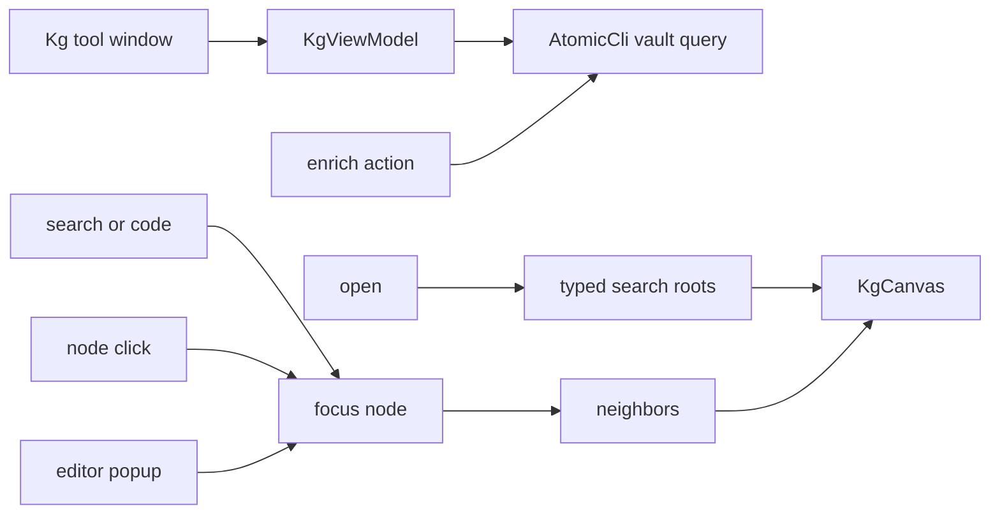

# Requirements

### Overview & Goals
Give developers a **dedicated Atomic Knowledge Graph tool window** that visualizes vault/code KG nodes (files, entities, changes, views, intents, goals, memories) and their edges, backed by `atomic vault query` — not the existing VCS Log change DAG.

### Scope
**In scope**
- New `atomic-kg` Gradle module and a tool window (not a Log tab, not change-record properties).
- CLI wrappers in `atomic-core` for `vault query search`, `code`, `neighbors`, `entities`, and `enrich`.
- Default **top-level roots** on open, then **expand-on-focus** (search, code hit, selected node, editor context).
- List + graph canvas; jump to file/line; toolbar Enrich when the graph is empty/stale.
- Editor **right-click** action: search the vault for the current selection (or the current file when nothing is selected).

**Out of scope**
- Replacing or merging with the Log change DAG (`changeGraph` / `AtomicLogProvider`).
- Driving the UI through MCP (`atomic-ai`).
- Dumping the entire KG into the canvas.
- Vault intent/memory authoring UI.
- Synthesizing `entity:` IDs from PSI; neighbor lookup only uses IDs returned by CLI.

### User Stories
- As a developer, I open the Atomic KG tool window and see a small set of root nodes so I know the graph exists.
- As a developer, I search names or code, then drill into neighbors on the canvas.
- As a developer, I run Enrich from the tool window when queries are empty.
- As a developer, I double-click a `file:` / code hit and land in the editor.
- As a developer, I select a name or snippet in the editor, choose **Search Atomic Vault**, and the KG tool window focuses that context.

### Functional Requirements
- Tool window available when the project is an Atomic repo (same `AtomicCli.isRepository` gate as VCS).
- Search box → `vault query search`; optional type filter (`entity`, `file`, `change`, …).
- Code search → `vault query code` with navigation to path/line.
- Selecting a node loads `vault query neighbors` and adds that hop to the canvas (does not replace unrelated roots unless the user starts a new search focus).
- Enrich action runs `atomic vault query enrich` and refreshes roots.
- Empty/error states: not a repo, CLI missing, graph not enriched, query failure.
- Editor popup action **Search Atomic Vault** (visible when project is an Atomic repo and an editor is focused):
  - Non-empty selection: `vault query code` with the selected text (path glob `-g` for the current file when the selection is long/multi-line); if the selection looks like a short identifier, also run `vault query search`.
  - No selection: `vault query entities` for the current file, then expand neighbors using IDs from that result (never invented IDs).
  - Opens/activates the KG tool window, seeds the search box, and focuses matching nodes.

### Non-Functional Requirements
- Queries on a background coroutine/pool; EDT only for Swing updates (same as `AtomicLogProvider`).
- No full-KG load; cap visible nodes (e.g. roots ≤ ~50, expand one hop at a time).
- No new commercial graph library; lightweight Swing canvas (pan/zoom, simple node/edge paint) to stay compatible with IntelliJ Community.

# Technical Design

### Current Implementation
- Modules: `atomic-core` (CLI/models/parsers), `atomic-vcs` (VCS Log DAG, commit, status bar), `atomic-ai` (MCP). Root `plugin.xml` + `build.gradle.kts` compose them.
- `AtomicCli.query` maps to `atomic query` (file/line matches), **not** `atomic vault query`.
- Only vault CLI today: `vaultContext`. Log graph is `changeGraph` + `viewHeads` in `AtomicLogProvider` — leave it alone.

### Key Decisions
1. **Dedicated tool window** in a new **`atomic-kg`** module (user choice).
2. **Roots then expand**: on open, seed a small root set; search/selection/editor context focuses a node and loads neighbors.
3. **Direct CLI** via `AtomicCli`, not MCP.
4. **Community-safe canvas**: custom `JPanel` graph, not IntelliJ Ultimate diagram APIs.
5. **Editor context is a first-class focus source**: selection → code/search; caret-only → file entities. Fits how the vault works (`code` = content index, `search` = KG names, `entities` = AST TOC for a path).

### Proposed Changes
Extend `AtomicCli` / `AtomicCliImpl` / `AtomicParsers` / `AtomicModels` with typed vault-query DTOs and `--json` parsing. Add `atomic-kg` IntelliJ-platform module depending on `atomic-core`, wire it in `settings.gradle.kts`, root `build.gradle.kts` (`implementation` + kover), and `plugin.xml` (`toolWindow` + optional action).

Seed roots with bounded `vault query search` calls by type (prefer `view`, `goal`, `intent`, recent `change` — skip if a type is unsupported). Code/search results become the focus set; `neighbors` uses **verbatim node IDs** from CLI JSON (never synthesized).

### Data Models / Contracts
```kotlin
data class KgNode(val id: String, val type: String, val name: String, val path: Path? = null, val line: Int? = null)
data class KgEdge(val fromId: String, val toId: String, val relation: String)
data class KgSearchResult(val nodes: List<KgNode>)
data class KgNeighborsResult(val centerId: String, val nodes: List<KgNode>, val edges: List<KgEdge>)
data class KgCodeHit(val path: Path, val line: Int?, val snippet: String)

interface AtomicCli {
    suspend fun vaultQuerySearch(repoPath: Path, query: String, type: String? = null, limit: Int = 50): KgSearchResult
    suspend fun vaultQueryCode(repoPath: Path, pattern: String, pathGlob: String? = null, fileType: String? = null): List<KgCodeHit>
    suspend fun vaultQueryNeighbors(repoPath: Path, nodeId: String): KgNeighborsResult
    suspend fun vaultQueryEntities(repoPath: Path, filePath: Path): KgSearchResult
    suspend fun vaultQueryEnrich(repoPath: Path)
}
```
CLI: `atomic vault query search|code|neighbors|entities|enrich` with `--json` when available; fall back to table parse like existing parsers.

### Components
- `KgToolWindowFactory` — registers tool window, repo-aware content.
- `KgViewModel` — roots, focus, graph model, loading/errors; calls `AtomicCli`.
- `KgSearchPanel` — search vs code mode, type filter, result list.
- `KgCanvas` — nodes/edges, pan/zoom, select → expand neighbors.
- `KgToolbar` — Enrich, Refresh, Fit graph.
- `KgSearchVaultAction` — `DumbAwareAction` in `EditorPopupMenu`; reads `CommonDataKeys.EDITOR` / `VIRTUAL_FILE` / selection; activates the tool window and calls `KgViewModel.focusFromEditor(...)`.

### File Structure
**Modify:** `settings.gradle.kts`, root `build.gradle.kts`, `src/main/resources/META-INF/plugin.xml`, `AtomicCli.kt`, `AtomicCliImpl.kt`, `AtomicModels.kt`, `AtomicParsers.kt`, tests in `atomic-core`.

**Add:** `atomic-kg/` with `build.gradle.kts` (mirror `atomic-vcs` IntelliJ module plugin), `src/main/kotlin/dev/atomic/kg/...` as above (including `KgSearchVaultAction`), unit tests for parsing/view-model merge of neighbor hops and editor-focus query choice.

### Architecture Diagram


### Risks
- JSON shapes for `vault query` may differ by CLI version — parsers must be defensive; show raw error in the tool window.
- Neighbor IDs must be copied from results; synthesizing `entity:` IDs will 404.
- Enrich can be slow — progress indicator, disable double-submit.

# Testing

### Validation Approach
Parser tests with fixture JSON/plain output (same style as `AtomicParsersTest` / `AtomicCliImplTest`). View-model tests: merge neighbor hops without duplicating nodes, cap roots, error flags. No GUI screenshot tests required.

### Key Scenarios
- Search JSON → `KgNode` list with stable ids.
- Neighbors JSON → edges + nodes; second expand unions into the graph.
- Code hit with line → navigation payload.
- Enrich invoked once; refresh reloads roots.
- Identifier selection → search+code; long selection → code with file glob; no selection → entities for file.

### Edge Cases
- Missing CLI / not a repo → empty state, no crash.
- Empty enrich / unknown node id → message, canvas unchanged.
- Truncated or non-JSON CLI output → parse fallback or error, never swallow on EDT.

# Delivery Steps

### ✓ Step 1: Add vault-query CLI APIs in atomic-core
AtomicCli can search, code-search, load neighbors, list file entities, and enrich the KG via `atomic vault query`.

- Add `KgNode` / `KgEdge` / result types in `AtomicModels.kt`.
- Extend `AtomicCli` + `AtomicCliImpl` with `vaultQuerySearch`, `vaultQueryCode`, `vaultQueryNeighbors`, `vaultQueryEntities`, `vaultQueryEnrich` (`--json` with plain fallback).
- Parse in `AtomicParsers.kt`; cover fixtures in `AtomicParsersTest` / `AtomicCliImplTest`.

### ✓ Step 2: Scaffold atomic-kg module and tool window shell
The plugin ships a new Atomic KG tool window module wired like vcs/ai.

- `include("atomic-kg")`, root dependencies/kover, `atomic-kg/build.gradle.kts` following `atomic-vcs`.
- Register `toolWindow` in `plugin.xml`; implement `KgToolWindowFactory` with empty/not-a-repo/error content.
- Toolbar stub: Refresh + Enrich calling `vaultQueryEnrich` with a progress indicator.

### ✓ Step 3: Search, code search, and editor navigation
Users can search the KG and jump from code hits to the editor.

- `KgSearchPanel` + `KgViewModel` calling search/code APIs.
- Result list; double-click / Enter opens file at line via OpenFileDescriptor.
- Type filter and loading/error labels.

### ✓ Step 4: Root-seeded graph canvas with neighbor expand
On open the canvas shows top-level roots; search or selection expands one hop of neighbors.

- Seed roots with bounded typed `vaultQuerySearch` (views/goals/intents/changes as available).
- `KgCanvas`: pan/zoom, node paint, select → `vaultQueryNeighbors`, union into the model with a node cap.
- Tests for hop merge/dedup; empty-graph hint pointing at Enrich.

### ✓ Step 5: Editor popup Search Atomic Vault
Right-click in the editor searches the vault for the selection or current file and focuses the KG tool window.

- Register `KgSearchVaultAction` on `EditorPopupMenu` in `plugin.xml`; enable only for Atomic repos with an editor.
- Selection heuristic: short identifier → `search` + `code`; longer/multi-line → `code` with `-g` current path; no selection → `entities` then neighbors from returned IDs.
- `KgViewModel.focusFromEditor` opens the tool window, fills the search box, and unions hits onto the canvas.
- Unit-test the query-choice heuristic (identifier vs snippet vs file).