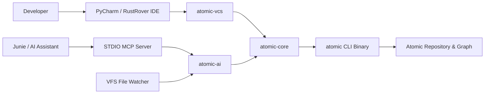

# Requirements

### Overview & Goals
The goal is to develop a standalone JetBrains IDE plugin supporting the **Atomic** version control system ([docs.atomic.dev](https://docs.atomic.dev)) for **PyCharm** and **RustRover** (IntelliJ Platform 2025.1+). The plugin maximizes developer productivity by bringing Atomic's patch-theory model and AI-native capabilities directly into the IDE workflow while preventing common Git-centric misconceptions.

### Concepts & Analogy (For Python, JavaScript & Rust Developers)
To bridge the gap between Java/Kotlin plugin development and non-Java ecosystems:
- **IntelliJ Plugin Architecture vs Node/Python**: JetBrains plugins are written in Kotlin (very similar to TypeScript and modern Rust) and configured via an XML manifest (`plugin.xml`, analogous to `package.json` or `Cargo.toml`).
- **Extension Points (SPI)**: JetBrains defines interfaces like `AbstractVcs` and `ChangeProvider`. Plugins register implementations in `plugin.xml` (like dependency injection or registering event hooks in Fastify/Express).
- **Atomic vs Git Paradigm**: Git tracks snapshots of trees across branches (`checkout` swaps the entire disk state). Atomic tracks commutative patches and **Views**. Views share a single working directory; switching views does not overwrite untracked files on disk. Commits are called **Records**, and changes are identified by **Blake3** content hashes.
- **Model Context Protocol (MCP)**: A JSON-RPC 2.0 protocol over `stdio` (similar to Language Server Protocol / LSP in Rust and TypeScript) allowing AI tools like Junie and AI Assistant to invoke plugin and CLI actions.

### Scope

#### In Scope (v1)
- **Core VCS Integration**:
  - Automatic root detection (`.atomic` directory mapping).
  - File status tracking in Project Tree and Local Changes (Modified, Added, Deleted, Untracked, Conflicted).
  - Editor gutter annotations and visual diff comparison.
  - Commit tool window integration for **Record** (`atomic record`) and Rollback (`atomic restore`).
  - Dedicated **Unrecord** action.
  - File and repository history view using Blake3 change hashes.
  - Status bar **View Switcher** widget (List, Switch, Create Draft View).
- **AI & Agent Integration**:
  - STDIO Model Context Protocol (MCP) server providing repo inspection, vault context, query search, and provenance inspection.
  - Automatic registration into JetBrains AI Assistant and Junie.
  - Agent session lifecycle tracking (`session_start`, `session_turn_end`, `session_end`, `attest`) that isolates AI changes onto dedicated draft views.
  - Virtual File System (VFS) fallback tracker ensuring edits made by AI models are recorded even if explicit turn-end tool calls are omitted.
- **Compatibility**:
  - Unified plugin distribution verified against **PyCharm 2025.1+** and **RustRover 2025.1+**.
  - Local CLI wrapper delegating to the installed `atomic` binary.

#### Out of Scope (v1)
- Full interactive visual Vault/Intent editor UI (MCP tools will provide context reading).
- Remote push/pull/sync UI and automated git-shadow synchronization.
- Direct embedded reimplementation of Atomic patch theory in JVM bytecode (the plugin delegates to the official `atomic` CLI).

### User Stories
- As a Python or Rust developer in PyCharm/RustRover, I want my Atomic repository status and diffs displayed natively so that I do not need to switch to an external terminal for basic version control.
- As a developer, I want to switch and create Atomic Views from the status bar with clear visual indicators that the working copy is shared, avoiding accidental loss of untracked files.
- As an AI Assistant / Junie user, I want AI agents to query Atomic semantic graphs and vault context directly through MCP to produce accurate, context-aware code modifications.
- As a project maintainer, I want AI code generations to be isolated in draft views with recorded turns and attestations, providing verifiable provenance for AI-assisted work.

### Functional Requirements
- **FR-1 Root Detection**: Discover Atomic roots via `atomic status` / `.atomic` marker and register them in **Settings → Version Control → Directory Mappings**.
- **FR-2 Status Mapping**: Map working tree state into IntelliJ file statuses (`FILE_STATUS_MODIFIED`, `FILE_STATUS_ADDED`, `FILE_STATUS_DELETED`, `FILE_STATUS_UNKNOWN`, `FILE_STATUS_MERGED_WITH_CONFLICTS`).
- **FR-3 Record & Rollback**: Allow staging and recording changes with commit messages; support rollback via `atomic restore`.
- **FR-4 History & Diffs**: Query and display patch log and change details via Blake3 hashes; provide file diffs against base revisions.
- **FR-5 View Management**: Status bar widget to view active view, switch views, and create draft views with warning dialogs regarding shared working trees.
- **FR-6 Settings**: Allow custom `atomic` binary path configuration, PATH discovery, and toggling AI MCP registration.
- **FR-7 MCP Server**: Expose STDIO MCP endpoint supporting `atomic_status`, `atomic_diff`, `atomic_log`, `atomic_change`, `atomic_query`, `atomic_vault_context`, and `atomic_provenance`.
- **FR-8 Agent Session Protocol**: Track `sessionId → agent-<sessionId>` draft views, recording changes per turn and attesting on session conclusion.
- **FR-9 VFS Safety Fallback**: Detect dirty files touched during active AI sessions and record them to the draft view if tool invocations were skipped.

### Non-Functional Requirements
- **UI Responsiveness**: All CLI interactions must execute asynchronously off the Event Dispatch Thread (EDT) using Kotlin Coroutines and background tasks.
- **Compatibility & Ergonomics**: Compliant with IntelliJ Platform 2025.1+ SDK standards (`since-build 251`), passing JetBrains Plugin Verifier checks for PyCharm and RustRover.
- **Failure Resilience**: Graceful degradation when `atomic` CLI is absent or when AI plugins are not installed, providing actionable notifications.

# Technical Design

### Current Implementation
Currently, the workspace contains initial exploratory notes and basic project scaffolding. The Atomic VCS is distributed as an external Rust-based CLI binary ([docs.atomic.dev](https://docs.atomic.dev)). JetBrains IDEs expose version control integration through the `com.intellij.openapi.vcs` SPI.

### Key Decisions
- **Decision 1: Kotlin Multi-Module Architecture**: Split into three focused Gradle modules (`atomic-core`, `atomic-vcs`, `atomic-ai`) packaged into a single plugin artifact.
  - *Rationale*: Maximizes maintainability, isolates VCS SPI dependencies from AI MCP protocols, and enables independent unit testing of CLI command serialization.
- **Decision 2: CLI Delegation over Reimplementation**: Delegate all VCS operations to the local `atomic` CLI (preferring `--json` output formats).
  - *Rationale*: Guarantees 100% fidelity with Atomic patch theory, Blake3 hashing, and ledger mechanics without duplicating complex VCS internals.
- **Decision 3: STDIO Model Context Protocol (MCP)**: Implement MCP as a lightweight STDIO server integrated into `atomic-core`.
  - *Rationale*: Conforms to standard JetBrains AI Assistant and Junie architecture without requiring network socket listeners or open TCP ports.
- **Decision 4: Dual-Layer Agent Provenance (MCP + VFS Fallback)**: Support explicit MCP session verbs with an IDE Virtual File System (VFS) listener fallback.
  - *Rationale*: Guarantees that AI-generated modifications are captured on draft views even when an LLM fails to invoke turn-end tools.
- **Decision 5: Independent Status Bar Widget**: Implement a custom view switcher rather than subclassing Git-specific widgets (`DvcsStatusWidget`).
  - *Rationale*: Eliminates coupling to `Git4Idea` and prevents user confusion between Git branches and Atomic shared-working-copy views.

### Proposed Changes
- Scaffold standalone Gradle plugin using Kotlin 2.x and IntelliJ Platform Gradle Plugin 2.x.
- **`atomic-core`**:
  - Implement `AtomicCli` interface with asynchronous execution and timeout handling.
  - Implement serialization/deserialization for CLI commands and DTOs.
- **`atomic-vcs`**:
  - Register `AtomicVcs` under extension point `com.intellij.vcs`.
  - Implement `AtomicChangeProvider` to map CLI status to IDE `ChangeListManager`.
  - Implement `AtomicCheckinEnvironment` to handle record actions and rollback operations.
  - Implement `AtomicHistoryProvider` and `AtomicDiffProvider` for patch logs and diff comparisons.
  - Implement `AtomicViewStatusBarWidget` for view management.
- **`atomic-ai`**:
  - Implement STDIO MCP server using Kotlin MCP SDK.
  - Implement `McpRegistrationActivity` to configure `llm.mcpServers.xml` and Junie project settings.
  - Implement `AtomicAgentSessionTracker` and `AtomicAiVfsListener` for AI session isolation.

### Data Models / Contracts

```kotlin
interface AtomicCli {
    suspend fun status(repoPath: Path): AtomicStatusResult
    suspend fun diff(repoPath: Path, paths: List<Path> = emptyList()): AtomicDiffResult
    suspend fun log(repoPath: Path, path: Path? = null, maxCount: Int = 100): List<AtomicChangeSummary>
    suspend fun change(repoPath: Path, changeHash: String): AtomicChangeDetail
    suspend fun record(repoPath: Path, message: String, paths: List<Path>): AtomicRecordResult
    suspend fun unrecord(repoPath: Path, changeHash: String? = null): Unit
    suspend fun restore(repoPath: Path, paths: List<Path>): Unit
    suspend fun add(repoPath: Path, paths: List<Path>): Unit
    suspend fun listViews(repoPath: Path): List<AtomicView>
    suspend fun switchView(repoPath: Path, viewName: String): Unit
    suspend fun createDraftView(repoPath: Path, viewName: String, parentView: String?): AtomicView
    suspend fun query(repoPath: Path, queryString: String): AtomicQueryResult
    suspend fun vaultContext(repoPath: Path, intent: String? = null): String
    suspend fun provenance(repoPath: Path, changeHash: String): AtomicProvenanceDetail
    suspend fun attest(repoPath: Path, viewName: String? = null): AtomicAttestation
}

data class AtomicStatusResult(
    val currentView: String,
    val modified: List<Path>,
    val added: List<Path>,
    val deleted: List<Path>,
    val untracked: List<Path>,
    val conflicted: List<Path>
)

data class AtomicChangeSummary(
    val hash: String, // Blake3 hash
    val message: String,
    val author: String,
    val timestamp: String,
    val isDraft: Boolean
)

data class AtomicView(
    val name: String,
    val isCurrent: Boolean,
    val isDraft: Boolean,
    val parentView: String?
)
```

### File Structure
```
atomic-intellij/
├── settings.gradle.kts
├── build.gradle.kts
├── gradle.properties
├── atomic-core/
│   └── src/main/kotlin/dev/atomic/core/
│       ├── cli/AtomicCli.kt
│       ├── cli/ProcessRunner.kt
│       └── model/AtomicModels.kt
├── atomic-vcs/
│   └── src/main/kotlin/dev/atomic/vcs/
│       ├── AtomicVcs.kt
│       ├── AtomicVcsRootChecker.kt
│       ├── AtomicChangeProvider.kt
│       ├── AtomicCheckinEnvironment.kt
│       ├── AtomicHistoryProvider.kt
│       ├── AtomicDiffProvider.kt
│       ├── ui/AtomicViewStatusBarWidget.kt
│       └── settings/AtomicSettingsConfigurable.kt
├── atomic-ai/
│   └── src/main/kotlin/dev/atomic/ai/
│       ├── mcp/AtomicMcpServer.kt
│       ├── mcp/McpRegistrationActivity.kt
│       ├── agent/AtomicAgentSessionTracker.kt
│       └── agent/AtomicAiVfsListener.kt
└── src/main/resources/META-INF/
    └── plugin.xml
```

### Architecture Diagram


### Risks
- **CLI Output Variance**: Variations between Atomic CLI versions and formatting changes in JSON outputs.
  - *Mitigation*: Isolate parser implementations behind strict DTO contracts and include fallback string parsers with diagnostic error logging.
- **AI Tool Skipping**: LLMs occasionally neglect to call session completion or turn recording tools.
  - *Mitigation*: The `AtomicAiVfsListener` tracks all file modifications during an active AI session and records pending modifications onto the draft view when session activity finishes.
- **IDE Freeze (EDT Violations)**: Running CLI processes on the UI thread causes IDE freezes.
  - *Mitigation*: Enforce asynchronous coroutine dispatchers (`Dispatchers.IO`) for all process executions and UI updates via `ModalityUiCoroutineContext`.
- **Missing CLI Binary**: Users opening projects without the `atomic` binary installed on their system path.
  - *Mitigation*: Display a non-intrusive warning notification with direct navigation to the Atomic configuration settings.

# Testing

### Validation Approach
Verification follows a multi-tier testing strategy ensuring functionality without requiring external network services:
1. **Core Unit & Serialization Testing**: Test `atomic-core` CLI runners and output parsers using mock process runners simulating JSON/text output fixtures.
2. **IntelliJ Platform Integration Fixtures**: Test `atomic-vcs` and `atomic-ai` using `BasePlatformTestCase` with mocked CLI responses to verify file status transitions and commit workflows.
3. **JetBrains Plugin Verifier**: Run automated verification across target IDE builds for **PyCharm Community/Professional (2025.1+)** and **RustRover (2025.1+)**.
4. **End-to-End Smoke Validation**: Run the plugin in a sandbox IDE instance against a sample Atomic repository to verify status bar rendering, diff inspection, and MCP tool responses.

### Key Scenarios
- **Repository Detection & Status Mapping**:
  - Open a project with an initialized `.atomic` root.
  - Verify that modified files appear with VCS file colors in the Project view and Local Changes window.
  - Verify untracked files are correctly enumerated without being locked.
- **Record & Rollback Operations**:
  - Stage changes and trigger Record from the Commit tool window.
  - Verify `atomic record` is invoked with the message and the working copy resets to clean status.
  - Trigger rollback on a modified file and verify `atomic restore` reverts disk contents.
- **View Switching**:
  - Switch active view using the Status Bar View Switcher.
  - Verify that untracked files are preserved in the shared working copy and the status bar updates its display.
- **MCP Server Discovery & Querying**:
  - Verify that AI Assistant / Junie configuration contains the registered Atomic MCP server on project startup.
  - Call `atomic_status` and `atomic_vault_context` via MCP and verify formatted structured responses.
- **Agent Session Isolation & Fallback**:
  - Start an AI session with `atomic_session_start` and verify creation of `agent-<sessionId>` view.
  - Perform edits without explicit `turn_end` calls and verify that VFS fallback records changes upon session finalization.

### Edge Cases
- **Missing or Invalid CLI Path**: Plugin displays a dismissible warning balloon with a settings link while keeping non-VCS IDE features operational.
- **Conflicted Files**: Merge conflicts from `atomic` are mapped to `FILE_STATUS_MERGED_WITH_CONFLICTS` and presented in the conflicts tool window.
- **Coexistence with Git**: Projects containing both `.git` and `.atomic` mappings do not experience hook or directory mapping collisions.
- **Corrupted CLI Response**: Malformed JSON responses from CLI crashes trigger handled errors rather than crashing the IDE background worker.

### Test Changes
- `atomic-core/src/test`: Unit tests for process runners, timeout handlers, and parser golden files.
- `atomic-vcs/src/test`: Platform test cases for `AtomicChangeProvider`, `AtomicCheckinEnvironment`, and `AtomicVcsRootChecker`.
- `atomic-ai/src/test`: JSON-RPC message validation for MCP endpoints and state machine tests for `AtomicAgentSessionTracker`.

# Delivery Steps

### ✓ Step 1: Scaffold standalone Kotlin Gradle plugin and implement Atomic CLI core layer
A standalone multi-module Gradle project exists that executes and parses local `atomic` CLI commands safely off the UI thread.
- Create standalone Gradle project structure with modules `:atomic-core`, `:atomic-vcs`, and `:atomic-ai` using IntelliJ Platform Gradle Plugin 2.x and Kotlin targeting Platform 2025.1+ (PyCharm and RustRover).
- Implement non-blocking CLI process execution wrapper in `atomic-core` with timeout handling and PATH detection.
- Implement typed data transfer objects and parsers (prioritizing `--json`) for `status`, `diff`, `log`, `change`, `record`, and `views`.
- Implement unit tests using mock CLI process fixtures for command serialization and error recovery.

### ✓ Step 2: Implement VCS root detection, working copy status mapping, and diff viewer
PyCharm and RustRover automatically recognize Atomic repositories, display file status colors in the Project view, and render file diffs.
- Implement `AtomicVcs` and `AtomicVcsRootChecker` to detect `.atomic` repositories and register directory mappings.
- Implement `AtomicChangeProvider` to map `atomic status` results onto IntelliJ file statuses (Modified, Added, Deleted, Untracked, Conflicted).
- Implement `AtomicDiffProvider` for editor gutter diffs and side-by-side comparison against recorded patches.
- Add IDE settings page for configuring the `atomic` binary path with auto-detection and missing-binary notifications.

### ✓ Step 3: Implement Commit tool window Record/Unrecord workflows and Status Bar View Switcher
Developers can record changes, view history with Blake3 hashes, and switch Atomic views from the status bar without Git branch misconceptions.
- Implement `AtomicCheckinEnvironment` to execute `atomic add` and `atomic record` from the Commit tool window, and rollback via `atomic restore`.
- Add an explicit `Atomic Unrecord` action distinct from Git reset operations.
- Implement `AtomicHistoryProvider` to display patch history and Blake3 change summaries.
- Create `AtomicViewStatusBarWidget` for listing, creating, and switching views, with explicit UI copy explaining that the working copy is shared across views.

### ✓ Step 4: Implement STDIO MCP server and JetBrains AI Assistant/Junie auto-registration
JetBrains AI Assistant and Junie can query Atomic repository context, changes, vault notes, and provenance via MCP tools.
- Implement STDIO Model Context Protocol (MCP) server in `atomic-ai` using the Kotlin MCP SDK, wrapping `atomic-core` operations.
- Expose read tools: `atomic_status`, `atomic_diff`, `atomic_log`, `atomic_change`, `atomic_query`, `atomic_vault_context`, and `atomic_provenance`.
- Implement `McpRegistrationActivity` to configure the STDIO server in JetBrains AI Assistant (`llm.mcpServers.xml`) and Junie project settings.
- Provide toggleable settings for automatic MCP registration and manual configuration snippets.

### ✓ Step 5: Implement AI agent session lifecycle management with VFS fallback recording
Junie and AI Assistant sessions operate on isolated Atomic draft views with turn recording, attestations, and automatic recovery of untracked edits.
- Implement MCP session verbs: `atomic_session_start`, `atomic_session_turn_end`, `atomic_session_end`, and `atomic_attest`.
- Implement `AtomicAgentSessionTracker` to split draft views (`agent-<sessionId>`) on session start and switch back on completion.
- Implement `AtomicAiVfsListener` to track virtual file system modifications during active AI sessions as a fallback mechanism for unrecorded turns.
- Provide prompt instructions and project rules (`.atomic/jetbrains-agent.md`) guiding AI agents to leverage Atomic semantic queries and turn management.