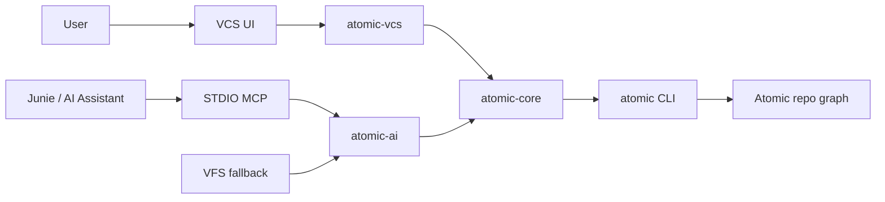

Configured authentication: Managed by agent

I'll start by inspecting this repo and Atomic's docs so the plugin plan matches both the existing layout and how Atomic actually works.

This repo is homelab config, not a plugin codebase — next I’ll pull Atomic’s docs and JetBrains VCS plugin patterns so the plan isn’t based on guesswork.

Fetch URL

Atomic is a patch-theory VCS (views, not Git branches) with vault/intent/provenance for AI. I’ll pull the CLI and JetBrains VCS plugin APIs next so the plan is concrete.

Fetch URL

Atomic is patch-based (views share one working copy, not Git branches). This repo is homelab config only, so I need a few scope choices before drafting the plugin plan.Atomic (docs.atomic.dev) is a Darcs/Pijul-style semantic change graph: **views are not Git branches** (they share the working copy), identity is content-addressed (Blake3), and AI work is first-class (vault, intents, provenance, attestations).

JetBrains already has a VCS plugin SPI (`AbstractVcs`, commit/history/diff, directory mappings) and AI surfaces (AI Assistant / Junie, MCP). The plugin should look familiar in the IDE, but the domain model must stay Atomic—not a fake Git overlay.

I will target **IntelliJ Platform 2025.1+** so the same artifact can be run in current **PyCharm** and **RustRover**, talking to the local `atomic` CLI (`--json` where available) rather than embedding a second implementation of the VCS.

How should the plugin connect Atomic to built-in JetBrains AI (AI Assistant / Junie) when you test in PyCharm and RustRover?: Both in v1
What should the first shippable plugin include? Atomic is not Git: views share one working copy, changes are commutative patches (record/insert/unrecord), and vault/intents/agent sessions sit on top of that graph.: Core VCS + AI
This repo is homelab Docker/Kubernetes config, not an IntelliJ plugin. Where should the plugin project live?: New standalone repo

You chose core VCS plus both AI paths, in a new repo. I’ll compare plugin architectures next so MCP, agent sessions, and the VCS SPI don’t fight each other.

JetBrains VCS is a fixed SPI (`AbstractVcs`); Junie/AI Assistant have no Atomic-style hooks, so agent recording has to be designed. I need you to pick the plugin shape and how those two AI paths attach.**Decided:** first release is core Atomic VCS **plus** JetBrains AI; AI means **both** MCP/context **and** treating Junie/AI Assistant as Atomic agents; new standalone Gradle plugin repo; test in **PyCharm** and **RustRover** on IntelliJ Platform **2025.1+**.

**Fixed by Atomic/JetBrains (not asking):** talk to the `atomic` CLI (`--json` where it exists); implement IntelliJ `AbstractVcs` (status, record as commit, history, diffs, view widget). Views share one working copy — the UI must not pretend they are Git branches.

These three choices shape module boundaries, how agent provenance is captured, and how Junie talks to the same core as the VCS UI.

Where should MCP tools run so Junie and AI Assistant in PyCharm/RustRover can call Atomic (status, log, change, query, vault context, session verbs)?: STDIO via core
Junie and AI Assistant do not expose Cursor-style SessionStart/Stop hooks. How should the IDE act as an Atomic agent (draft view, turn record, provenance, attestation)?: MCP protocol plus fallback
How should the new standalone plugin be structured internally? One Marketplace artifact either way; this is about module boundaries.: Three Gradle modules

Architecture is locked: three Gradle modules, STDIO MCP through shared core, and agent sessions via MCP plus a VFS fallback. I’ll submit the plan for the new standalone plugin repo next.**Requirements**

**Overview & Goals**

Build a **new standalone IntelliJ Platform plugin** (not in this homelab-configuration repo) that treats [Atomic](https://docs.atomic.dev) as a first-class VCS in PyCharm and RustRover, and wires it into JetBrains AI (Junie + AI Assistant).

Atomic is a Darcs/Pijul-style semantic change graph. **Views are not Git branches**: they share one working copy; only patch history is isolated. The plugin must use Atomic language (record, unrecord, insert, view) and never fake a Git branch model.

**Scope**

**In Scope (v1)**

- Core VCS in the IDE: root mapping, file status colors, diffs, record/unrecord, log/history, conflicts, view list/switch widget.
- JetBrains AI in the same release:
    - **MCP + context**: STDIO MCP tools (status, diff, log, change, query, vault context, provenance, session verbs) auto-registered for Junie and AI Assistant.
    - **IDE as Atomic agent**: MCP session protocol (draft view, turn record, attest) plus VFS fallback if the model skips a tool call.
- Single Marketplace-style artifact, three Gradle modules (`atomic-core`, `atomic-vcs`, `atomic-ai`).
- Target **IntelliJ Platform 2025.1+** (`since-build` 251), verified in **PyCharm** and **RustRover**.
- Talk to the local `atomic` CLI (`--json` when present); do not reimplement the VCS.

**Out of Scope (v1)**

- Full Vault/Intent/Memory **UI** (MCP/tools may *read* vault context; no intent editor).
- Remotes/clone/push UI, git-shadow sync, Marketplace publishing/signing polish.
- Rider, and treating views as Git branches.
- Upstream `atomic agent enable --agent jetbrains` (nice follow-up; v1 implements the protocol in-plugin).

**User Stories**

- As a developer in PyCharm/RustRover, I want Atomic file status, diffs, and a Record action in the Commit tool window so I can work without leaving the IDE.
- As a developer, I want a status-bar **view** switcher (not a branch widget) so I can list/switch/create draft views without confusing them with Git.
- As someone using Junie or AI Assistant, I want Atomic graph/vault/provenance tools so the agent can query the repo instead of grepping blindly.
- As a reviewer of AI work, I want each Junie/AI session on an isolated Atomic draft view with recorded turns and an attestation, even if the model forgets a session tool call.

**Functional Requirements**

- Detect Atomic roots (CLI/`atomic status` + on-disk marker, expected `.atomic` or documented equivalent) and register them in **Settings → Version Control → Directory Mappings**.
- Map working-copy state onto IDE file statuses (modified / added / deleted / untracked / conflicted).
- Commit tool window **records** a change (`atomic add` as needed + `atomic record -m`); rollback uses `atomic restore` on selected paths; **Unrecord** is a separate VCS action (not Git reset).
- Show history per file/repo via `atomic log` / `atomic change <hash>`; editor diffs via `atomic diff`.
- Status bar shows **current view**; popup: list, switch, new draft. Switching a view must warn that the working copy is shared (untracked files remain).
- Settings: path to `atomic` (PATH auto-detect), enable MCP registration, enable agent sessions, parent view for agent drafts.
- On project open, if enabled, register a STDIO MCP server in Junie and AI Assistant config (handle 2025.1 vs newer schema).
- Agent session: `session_start` creates/switches to a draft view; turn end runs status/add/record + provenance; session end attests and switches back. VFS fallback records remaining dirty files onto that view if tools were skipped.
- Coexist with Git: do not steal Git mappings; Atomic and Git may both be present (git-shadow is not automated in v1).

**Non-Functional Requirements**

- Never run the CLI on the EDT; use coroutines/background tasks with timeouts and user-visible errors if `atomic` is missing.
- Plugin Verifier against PyCharm 2025.1+ and RustRover 2025.1+.
- Kotlin, Gradle IntelliJ Platform Plugin 2.x, JVM 21.

**Technical Design**

**Current Implementation**

This homelab-configuration repo has **no plugin code**. Atomic is an external CLI ([commands overview](https://docs.atomic.dev/commands/overview), [agent workflows](https://docs.atomic.dev/getting-started/ai-agent-workflows)). JetBrains VCS plugins implement `AbstractVcs` and related SPIs ([VCS integration](https://plugins.jetbrains.com/docs/intellij/vcs-integration-for-plugins.html)).

**Key Decisions**

- **New standalone repo** (Gradle + Kotlin), not a folder in homelab-configuration.
- **Three modules, one plugin zip**: `atomic-core` (CLI + DTOs), `atomic-vcs` (IntelliJ VCS SPI + UI), `atomic-ai` (STDIO MCP + agent tracker). `atomic-ai` may call core only; it must not parse CLI itself.
- **CLI is the source of truth.** Prefer `--json`; fall back to stable text parsers and fail clearly when output is unknown. Discover the binary via settings, then `PATH`.
- **MCP is STDIO**, implemented against `atomic-core`, auto-registered into Junie and AI Assistant. No extra HTTP port.
- **Agent sessions**: MCP verbs are canonical; **VFS + session-end fallback** still records AI-touched files onto the draft view so provenance is incomplete rather than missing.
- **Do not depend on Git4Idea.** Own status-bar widget and actions so PyCharm/RustRover do not need Git plugin internals (`DvcsStatusWidget` is historically entangled with Git4Idea).
- **Platform 2025.1+** (`com.intellij.modules.platform` + VCS module). Same artifact for PyCharm and RustRover.

**Proposed Changes**

Scaffold from [IntelliJ Platform Plugin Template](https://github.com/JetBrains/intellij-platform-plugin-template), then split into the three modules. Root project applies `org.jetbrains.intellij.platform` and assembles `:vcs` + `:ai` + `:core`.

**atomic-core** owns process execution (`AtomicCli`), repo detection (`AtomicRepositoryLocator`), and typed commands. All IDE and MCP features go through this API.

**atomic-vcs** registers `AtomicVcs` on `com.intellij.vcs`. `ChangeProvider` refreshes dirty scopes via `atomic status`. Checkin maps to record (UI copy: Record, not Commit). History/diff providers use change hashes (Blake3), not integer revisions. Status bar widget is view-centric and documents shared working copy on switch.

**atomic-ai** ships a STDIO MCP entrypoint (Kotlin MCP SDK) whose tools call `AtomicCli`. A project activity writes MCP server entries (AI Assistant `llm.mcpServers.xml` / 2025.1 flat vs newer `commands`/`urls` layout; Junie project MCP). `AtomicAgentSessionTracker` holds `sessionId → draftView`. `AtomicAiVfsListener` records paths touched while a session is active for fallback record on turn/session end.

Install a short project rule (e.g. `.atomic/jetbrains-agent.md` and a Junie/AI instruction snippet) telling the agent to call `atomic_session_start` / `atomic_session_turn_end` / `atomic_session_end` and to use query/vault tools before grepping.

**Data Models / Contracts**

Core command surface (illustrative):

```kotlin
interface AtomicCli {
  suspend fun status(repo: Path): AtomicStatus
  suspend fun diff(repo: Path, paths: List<Path> = emptyList()): AtomicDiff
  suspend fun log(repo: Path, path: Path? = null, view: String? = null): List<AtomicChangeSummary>
  suspend fun change(repo: Path, hash: String): AtomicChangeDetail
  suspend fun record(repo: Path, message: String, paths: List<Path>): AtomicChangeSummary
  suspend fun unrecord(repo: Path): Unit
  suspend fun restore(repo: Path, paths: List<Path>): Unit
  suspend fun add(repo: Path, paths: List<Path>): Unit
  suspend fun views(repo: Path): List<AtomicView>
  suspend fun switchView(repo: Path, name: String): Unit
  suspend fun splitView(repo: Path, name: String, parent: String?): AtomicView
  suspend fun querySearch(repo: Path, q: String): AtomicQueryResult
  suspend fun vaultContext(repo: Path, intent: String? = null): String
  suspend fun provenance(repo: Path, hash: String): String
  suspend fun agentStatus(repo: Path): AtomicAgentStatus
  suspend fun attest(repo: Path, view: String? = null): AtomicAttestation
}
```

DTOs: `AtomicStatus` (per-path state + current view), `AtomicView` (name, shared vs draft, parent), `AtomicChangeSummary` (hash, message, author, timestamp), `AtomicChangeDetail` (+ ledger / AI metadata when CLI provides it).

MCP tools (STDIO): `atomic_status`, `atomic_diff`, `atomic_log`, `atomic_change`, `atomic_query`, `atomic_vault_context`, `atomic_provenance`, `atomic_session_start`, `atomic_session_turn_end`, `atomic_session_end`, `atomic_attest`.

Agent protocol: start → `split`/`view` draft from configured parent, named `agent-<sessionId>`; each turn end → `status`/`add`/`record` with goal text; end → `agent attest` (or equivalent CLI) + switch back to parent. Fallback: union of VFS-touched paths if `status` is dirty and the model skipped turn_end.

**File Structure**

New repo `atomic-intellij/` (name can vary):

```
atomic-intellij/
  settings.gradle.kts
  build.gradle.kts              # plugin packaging, verifier IDEs
  gradle.properties             # platformVersion=2025.1, plugin id
  README.md
  core/src/main/kotlin/.../cli/AtomicCli.kt
  core/src/test/kotlin/...      # fake process fixtures
  vcs/src/main/kotlin/.../AtomicVcs.kt
  vcs/src/main/kotlin/.../AtomicChangeProvider.kt
  vcs/src/main/kotlin/.../AtomicCheckinEnvironment.kt
  vcs/src/main/kotlin/.../AtomicHistoryProvider.kt
  vcs/src/main/kotlin/.../AtomicViewStatusBarWidget.kt
  ai/src/main/kotlin/.../mcp/AtomicMcpServer.kt
  ai/src/main/kotlin/.../mcp/McpRegistrationActivity.kt
  ai/src/main/kotlin/.../agent/AtomicAgentSessionTracker.kt
  ai/src/main/kotlin/.../agent/AtomicAiVfsListener.kt
  src/main/resources/META-INF/plugin.xml
```

`plugin.xml`: `com.intellij.vcs` → `AtomicVcs`; `vcsRootChecker`; `statusBarWidgetFactory`; `applicationConfigurable`; `projectActivity` for MCP registration; VCS actions (Record, Unrecord, Switch View); applicationListener/VFS for agent fallback.

**Architecture Diagram**



**Risks**

- **Uneven `--json` coverage** — probe each verb; isolate parsers behind interfaces; golden-file tests from real CLI output.
- **AI Assistant / Junie MCP schemas differ by IDE version** — detect layout; keep registration behind a setting; degrade to a copy-paste MCP snippet in README if write fails.
- **No public Junie session API** — protocol is MCP + rules; fallback is VFS, not private AI APIs.
- **Shared working copy** — view switch must not look like `git checkout`; copy and confirmations must say untracked files remain.
- **Git coexistence** — root checker only claims directories that are Atomic repos.
- **EDT / freeze** — all CLI I/O off-EDT; progress for record/log.
- **Missing CLI** — balloon + settings link; VCS mapping still visible but operations disabled.

**Testing**

**Validation Approach**

- **core**: unit tests with a fake `atomic` process (scripted stdout/stderr/exit). No real IDE.
- **vcs/ai**: IntelliJ Platform test fixtures + the same fake CLI. Run plugin verifier for PyCharm and RustRover 2025.1+.
- Manual smoke: Run Plugin in PyCharm and RustRover against a throwaway `atomic init` repo (documented in README). Full Junie live sessions are not CI-blocking.

**Key Scenarios**

- Open a project with an Atomic root → directory mapping appears; modified files get VCS colors; Local Changes matches `atomic status`.
- Record from Commit tool window → `atomic record` creates a change; history shows its hash; unrecord removes it from the current view.
- View widget lists views, switches, and creates a draft; untracked files remain after switch.
- MCP registration on project open → Junie/AI Assistant settings contain the STDIO server; tools return status/log from the open project.
- `atomic_session_start` → draft view; edits + `turn_end` → recorded change with message; `session_end` → attest + switch back.
- Skip `turn_end`, edit files, end session → fallback records dirty/VFS-touched paths onto the draft view.

**Edge Cases**

- `atomic` not on PATH / invalid binary path.
- Command without `--json` or unexpected schema.
- Conflicted files (`atomic conflicts`) surface as conflicted status.
- Git repo nested or alongside Atomic: Git mappings unchanged.
- CLI timeout / non-zero exit shown in VCS notifications, not a freeze.
- MCP registration no-ops when Junie/AI Assistant is not installed.

**Test Changes**

- `core`: parser tests per CLI verb; process timeout/error mapping.
- `vcs`: `ChangeProvider` dirty-scope tests with fixture files; record/unrecord action tests against fake CLI.
- `ai`: MCP tool JSON-RPC smoke (initialize + `atomic_status`); session tracker state machine (start/turn/end/fallback) without a real model.

**Delivery Steps**

**Step 1: Scaffold repo and atomic-core CLI**

A new Gradle/Kotlin plugin repo exists with three modules, and `atomic-core` can run/parse Atomic CLI commands under test.

- Create standalone `atomic-intellij` from the IntelliJ Platform Plugin Template (Kotlin, Platform 2025.1, JVM 21); do not add it to homelab-configuration.
- Split `core`, `vcs`, `ai`; root `plugin.xml` + packaging depend on all three.
- Implement `AtomicCli` (off-EDT, timeouts), binary discovery, and DTOs for `status`, `diff`, `log`, `change`, `record`, `views`.
- Add fake-process unit tests and README (dev run in PyCharm/RustRover, required `atomic` CLI).

**Step 2: VCS root, file status, and diffs**

PyCharm/RustRover map Atomic roots and show working-copy status and diffs like other VCS plugins.

- Implement `AtomicVcs`, `AtomicVcsRootChecker`, and directory-mapping integration.
- Implement `AtomicChangeProvider` from `atomic status` (modified/added/deleted/untracked/conflicted).
- Implement `AtomicDiffProvider` / editor diff against last recorded content.
- Settings page for CLI path; missing-binary notification; keep Git mappings untouched.

**Step 3: Record, history, and view widget**

The Commit tool window records Atomic changes, history uses change hashes, and the status bar switches views without Git-branch semantics.

- `AtomicCheckinEnvironment`: add + record with message; rollback via `restore`; separate Unrecord action.
- `AtomicHistoryProvider` from `atomic log` / `atomic change` (Blake3 hashes).
- `AtomicViewStatusBarWidget`: list/switch/create draft; warn that the working copy is shared.
- Plugin tests with fake CLI for record/status/history; verifier includes PyCharm and RustRover.

**Step 4: STDIO MCP and AI context tools**

Junie and AI Assistant can call Atomic tools that share `atomic-core` with the VCS layer.

- STDIO MCP server tools: status, diff, log, change, query, vault context, provenance.
- Project activity auto-registers the server in Junie and AI Assistant config (2025.1 vs newer schema); setting to disable.
- No-op when those plugins are absent; README documents manual MCP snippet.
- Smoke tests: MCP initialize + `atomic_status` against fake CLI.

**Step 5: Agent session protocol and VFS fallback**

Junie/AI Assistant sessions land on Atomic draft views with turn recording and attestations; skipped tool calls still record via VFS fallback.

- MCP verbs `atomic_session_start` / `turn_end` / `session_end` / `atomic_attest` plus `AtomicAgentSessionTracker` (draft `agent-<sessionId>`).
- Project rule snippet instructing Junie/AI Assistant to call those verbs and to use query/vault tools.
- `AtomicAiVfsListener` tracks edits during a session; session/turn end records remaining dirty paths if the model skipped a call.
- State-machine tests for start/turn/end and fallback; README smoke steps for a live Junie run in PyCharm and RustRover.


**Requirements**

**Overview & Goals**

Build a **new standalone IntelliJ Platform plugin** (not in this homelab-configuration repo) that treats [Atomic](https://docs.atomic.dev) as a first-class VCS in PyCharm and RustRover, and wires it into JetBrains AI (Junie + AI Assistant).

Atomic is a Darcs/Pijul-style semantic change graph. **Views are not Git branches**: they share one working copy; only patch history is isolated. The plugin must use Atomic language (record, unrecord, insert, view) and never fake a Git branch model.

**Scope**

**In Scope (v1)**

- Core VCS in the IDE: root mapping, file status colors, diffs, record/unrecord, log/history, conflicts, view list/switch widget.
- JetBrains AI in the same release:
    - **MCP + context**: STDIO MCP tools (status, diff, log, change, query, vault context, provenance, session verbs) auto-registered for Junie and AI Assistant.
    - **IDE as Atomic agent**: MCP session protocol (draft view, turn record, attest) plus VFS fallback if the model skips a tool call.
- Single Marketplace-style artifact, three Gradle modules (`atomic-core`, `atomic-vcs`, `atomic-ai`).
- Target **IntelliJ Platform 2025.1+** (`since-build` 251), verified in **PyCharm** and **RustRover**.
- Talk to the local `atomic` CLI (`--json` when present); do not reimplement the VCS.

**Out of Scope (v1)**

- Full Vault/Intent/Memory **UI** (MCP/tools may *read* vault context; no intent editor).
- Remotes/clone/push UI, git-shadow sync, Marketplace publishing/signing polish.
- Rider, and treating views as Git branches.
- Upstream `atomic agent enable --agent jetbrains` (nice follow-up; v1 implements the protocol in-plugin).

**User Stories**

- As a developer in PyCharm/RustRover, I want Atomic file status, diffs, and a Record action in the Commit tool window so I can work without leaving the IDE.
- As a developer, I want a status-bar **view** switcher (not a branch widget) so I can list/switch/create draft views without confusing them with Git.
- As someone using Junie or AI Assistant, I want Atomic graph/vault/provenance tools so the agent can query the repo instead of grepping blindly.
- As a reviewer of AI work, I want each Junie/AI session on an isolated Atomic draft view with recorded turns and an attestation, even if the model forgets a session tool call.

**Functional Requirements**

- Detect Atomic roots (CLI/`atomic status` + on-disk marker, expected `.atomic` or documented equivalent) and register them in **Settings → Version Control → Directory Mappings**.
- Map working-copy state onto IDE file statuses (modified / added / deleted / untracked / conflicted).
- Commit tool window **records** a change (`atomic add` as needed + `atomic record -m`); rollback uses `atomic restore` on selected paths; **Unrecord** is a separate VCS action (not Git reset).
- Show history per file/repo via `atomic log` / `atomic change <hash>`; editor diffs via `atomic diff`.
- Status bar shows **current view**; popup: list, switch, new draft. Switching a view must warn that the working copy is shared (untracked files remain).
- Settings: path to `atomic` (PATH auto-detect), enable MCP registration, enable agent sessions, parent view for agent drafts.
- On project open, if enabled, register a STDIO MCP server in Junie and AI Assistant config (handle 2025.1 vs newer schema).
- Agent session: `session_start` creates/switches to a draft view; turn end runs status/add/record + provenance; session end attests and switches back. VFS fallback records remaining dirty files onto that view if tools were skipped.
- Coexist with Git: do not steal Git mappings; Atomic and Git may both be present (git-shadow is not automated in v1).

**Non-Functional Requirements**

- Never run the CLI on the EDT; use coroutines/background tasks with timeouts and user-visible errors if `atomic` is missing.
- Plugin Verifier against PyCharm 2025.1+ and RustRover 2025.1+.
- Kotlin, Gradle IntelliJ Platform Plugin 2.x, JVM 21.

**Technical Design**

**Current Implementation**

This homelab-configuration repo has **no plugin code**. Atomic is an external CLI ([commands overview](https://docs.atomic.dev/commands/overview), [agent workflows](https://docs.atomic.dev/getting-started/ai-agent-workflows)). JetBrains VCS plugins implement `AbstractVcs` and related SPIs ([VCS integration](https://plugins.jetbrains.com/docs/intellij/vcs-integration-for-plugins.html)).

**Key Decisions**

- **New standalone repo** (Gradle + Kotlin), not a folder in homelab-configuration.
- **Three modules, one plugin zip**: `atomic-core` (CLI + DTOs), `atomic-vcs` (IntelliJ VCS SPI + UI), `atomic-ai` (STDIO MCP + agent tracker). `atomic-ai` may call core only; it must not parse CLI itself.
- **CLI is the source of truth.** Prefer `--json`; fall back to stable text parsers and fail clearly when output is unknown. Discover the binary via settings, then `PATH`.
- **MCP is STDIO**, implemented against `atomic-core`, auto-registered into Junie and AI Assistant. No extra HTTP port.
- **Agent sessions**: MCP verbs are canonical; **VFS + session-end fallback** still records AI-touched files onto the draft view so provenance is incomplete rather than missing.
- **Do not depend on Git4Idea.** Own status-bar widget and actions so PyCharm/RustRover do not need Git plugin internals (`DvcsStatusWidget` is historically entangled with Git4Idea).
- **Platform 2025.1+** (`com.intellij.modules.platform` + VCS module). Same artifact for PyCharm and RustRover.

**Proposed Changes**

Scaffold from [IntelliJ Platform Plugin Template](https://github.com/JetBrains/intellij-platform-plugin-template), then split into the three modules. Root project applies `org.jetbrains.intellij.platform` and assembles `:vcs` + `:ai` + `:core`.

**atomic-core** owns process execution (`AtomicCli`), repo detection (`AtomicRepositoryLocator`), and typed commands. All IDE and MCP features go through this API.

**atomic-vcs** registers `AtomicVcs` on `com.intellij.vcs`. `ChangeProvider` refreshes dirty scopes via `atomic status`. Checkin maps to record (UI copy: Record, not Commit). History/diff providers use change hashes (Blake3), not integer revisions. Status bar widget is view-centric and documents shared working copy on switch.

**atomic-ai** ships a STDIO MCP entrypoint (Kotlin MCP SDK) whose tools call `AtomicCli`. A project activity writes MCP server entries (AI Assistant `llm.mcpServers.xml` / 2025.1 flat vs newer `commands`/`urls` layout; Junie project MCP). `AtomicAgentSessionTracker` holds `sessionId → draftView`. `AtomicAiVfsListener` records paths touched while a session is active for fallback record on turn/session end.

Install a short project rule (e.g. `.atomic/jetbrains-agent.md` and a Junie/AI instruction snippet) telling the agent to call `atomic_session_start` / `atomic_session_turn_end` / `atomic_session_end` and to use query/vault tools before grepping.

**Data Models / Contracts**

Core command surface (illustrative):

```kotlin
interface AtomicCli {
  suspend fun status(repo: Path): AtomicStatus
  suspend fun diff(repo: Path, paths: List<Path> = emptyList()): AtomicDiff
  suspend fun log(repo: Path, path: Path? = null, view: String? = null): List<AtomicChangeSummary>
  suspend fun change(repo: Path, hash: String): AtomicChangeDetail
  suspend fun record(repo: Path, message: String, paths: List<Path>): AtomicChangeSummary
  suspend fun unrecord(repo: Path): Unit
  suspend fun restore(repo: Path, paths: List<Path>): Unit
  suspend fun add(repo: Path, paths: List<Path>): Unit
  suspend fun views(repo: Path): List<AtomicView>
  suspend fun switchView(repo: Path, name: String): Unit
  suspend fun splitView(repo: Path, name: String, parent: String?): AtomicView
  suspend fun querySearch(repo: Path, q: String): AtomicQueryResult
  suspend fun vaultContext(repo: Path, intent: String? = null): String
  suspend fun provenance(repo: Path, hash: String): String
  suspend fun agentStatus(repo: Path): AtomicAgentStatus
  suspend fun attest(repo: Path, view: String? = null): AtomicAttestation
}
```

DTOs: `AtomicStatus` (per-path state + current view), `AtomicView` (name, shared vs draft, parent), `AtomicChangeSummary` (hash, message, author, timestamp), `AtomicChangeDetail` (+ ledger / AI metadata when CLI provides it).

MCP tools (STDIO): `atomic_status`, `atomic_diff`, `atomic_log`, `atomic_change`, `atomic_query`, `atomic_vault_context`, `atomic_provenance`, `atomic_session_start`, `atomic_session_turn_end`, `atomic_session_end`, `atomic_attest`.

Agent protocol: start → `split`/`view` draft from configured parent, named `agent-<sessionId>`; each turn end → `status`/`add`/`record` with goal text; end → `agent attest` (or equivalent CLI) + switch back to parent. Fallback: union of VFS-touched paths if `status` is dirty and the model skipped turn_end.

**File Structure**

New repo `atomic-intellij/` (name can vary):

```
atomic-intellij/
  settings.gradle.kts
  build.gradle.kts              # plugin packaging, verifier IDEs
  gradle.properties             # platformVersion=2025.1, plugin id
  README.md
  core/src/main/kotlin/.../cli/AtomicCli.kt
  core/src/test/kotlin/...      # fake process fixtures
  vcs/src/main/kotlin/.../AtomicVcs.kt
  vcs/src/main/kotlin/.../AtomicChangeProvider.kt
  vcs/src/main/kotlin/.../AtomicCheckinEnvironment.kt
  vcs/src/main/kotlin/.../AtomicHistoryProvider.kt
  vcs/src/main/kotlin/.../AtomicViewStatusBarWidget.kt
  ai/src/main/kotlin/.../mcp/AtomicMcpServer.kt
  ai/src/main/kotlin/.../mcp/McpRegistrationActivity.kt
  ai/src/main/kotlin/.../agent/AtomicAgentSessionTracker.kt
  ai/src/main/kotlin/.../agent/AtomicAiVfsListener.kt
  src/main/resources/META-INF/plugin.xml
```

`plugin.xml`: `com.intellij.vcs` → `AtomicVcs`; `vcsRootChecker`; `statusBarWidgetFactory`; `applicationConfigurable`; `projectActivity` for MCP registration; VCS actions (Record, Unrecord, Switch View); applicationListener/VFS for agent fallback.

**Architecture Diagram**


**Risks**

- **Uneven `--json` coverage** — probe each verb; isolate parsers behind interfaces; golden-file tests from real CLI output.
- **AI Assistant / Junie MCP schemas differ by IDE version** — detect layout; keep registration behind a setting; degrade to a copy-paste MCP snippet in README if write fails.
- **No public Junie session API** — protocol is MCP + rules; fallback is VFS, not private AI APIs.
- **Shared working copy** — view switch must not look like `git checkout`; copy and confirmations must say untracked files remain.
- **Git coexistence** — root checker only claims directories that are Atomic repos.
- **EDT / freeze** — all CLI I/O off-EDT; progress for record/log.
- **Missing CLI** — balloon + settings link; VCS mapping still visible but operations disabled.

**Testing**

**Validation Approach**

- **core**: unit tests with a fake `atomic` process (scripted stdout/stderr/exit). No real IDE.
- **vcs/ai**: IntelliJ Platform test fixtures + the same fake CLI. Run plugin verifier for PyCharm and RustRover 2025.1+.
- Manual smoke: Run Plugin in PyCharm and RustRover against a throwaway `atomic init` repo (documented in README). Full Junie live sessions are not CI-blocking.

**Key Scenarios**

- Open a project with an Atomic root → directory mapping appears; modified files get VCS colors; Local Changes matches `atomic status`.
- Record from Commit tool window → `atomic record` creates a change; history shows its hash; unrecord removes it from the current view.
- View widget lists views, switches, and creates a draft; untracked files remain after switch.
- MCP registration on project open → Junie/AI Assistant settings contain the STDIO server; tools return status/log from the open project.
- `atomic_session_start` → draft view; edits + `turn_end` → recorded change with message; `session_end` → attest + switch back.
- Skip `turn_end`, edit files, end session → fallback records dirty/VFS-touched paths onto the draft view.

**Edge Cases**

- `atomic` not on PATH / invalid binary path.
- Command without `--json` or unexpected schema.
- Conflicted files (`atomic conflicts`) surface as conflicted status.
- Git repo nested or alongside Atomic: Git mappings unchanged.
- CLI timeout / non-zero exit shown in VCS notifications, not a freeze.
- MCP registration no-ops when Junie/AI Assistant is not installed.

**Test Changes**

- `core`: parser tests per CLI verb; process timeout/error mapping.
- `vcs`: `ChangeProvider` dirty-scope tests with fixture files; record/unrecord action tests against fake CLI.
- `ai`: MCP tool JSON-RPC smoke (initialize + `atomic_status`); session tracker state machine (start/turn/end/fallback) without a real model.

**Delivery Steps**

**Step 1: Scaffold repo and atomic-core CLI**

A new Gradle/Kotlin plugin repo exists with three modules, and `atomic-core` can run/parse Atomic CLI commands under test.

- Create standalone `atomic-intellij` from the IntelliJ Platform Plugin Template (Kotlin, Platform 2025.1, JVM 21); do not add it to homelab-configuration.
- Split `core`, `vcs`, `ai`; root `plugin.xml` + packaging depend on all three.
- Implement `AtomicCli` (off-EDT, timeouts), binary discovery, and DTOs for `status`, `diff`, `log`, `change`, `record`, `views`.
- Add fake-process unit tests and README (dev run in PyCharm/RustRover, required `atomic` CLI).

**Step 2: VCS root, file status, and diffs**

PyCharm/RustRover map Atomic roots and show working-copy status and diffs like other VCS plugins.

- Implement `AtomicVcs`, `AtomicVcsRootChecker`, and directory-mapping integration.
- Implement `AtomicChangeProvider` from `atomic status` (modified/added/deleted/untracked/conflicted).
- Implement `AtomicDiffProvider` / editor diff against last recorded content.
- Settings page for CLI path; missing-binary notification; keep Git mappings untouched.

**Step 3: Record, history, and view widget**

The Commit tool window records Atomic changes, history uses change hashes, and the status bar switches views without Git-branch semantics.

- `AtomicCheckinEnvironment`: add + record with message; rollback via `restore`; separate Unrecord action.
- `AtomicHistoryProvider` from `atomic log` / `atomic change` (Blake3 hashes).
- `AtomicViewStatusBarWidget`: list/switch/create draft; warn that the working copy is shared.
- Plugin tests with fake CLI for record/status/history; verifier includes PyCharm and RustRover.

**Step 4: STDIO MCP and AI context tools**

Junie and AI Assistant can call Atomic tools that share `atomic-core` with the VCS layer.

- STDIO MCP server tools: status, diff, log, change, query, vault context, provenance.
- Project activity auto-registers the server in Junie and AI Assistant config (2025.1 vs newer schema); setting to disable.
- No-op when those plugins are absent; README documents manual MCP snippet.
- Smoke tests: MCP initialize + `atomic_status` against fake CLI.

**Step 5: Agent session protocol and VFS fallback**

Junie/AI Assistant sessions land on Atomic draft views with turn recording and attestations; skipped tool calls still record via VFS fallback.

- MCP verbs `atomic_session_start` / `turn_end` / `session_end` / `atomic_attest` plus `AtomicAgentSessionTracker` (draft `agent-<sessionId>`).
- Project rule snippet instructing Junie/AI Assistant to call those verbs and to use query/vault tools.
- `AtomicAiVfsListener` tracks edits during a session; session/turn end records remaining dirty paths if the model skipped a call.
- State-machine tests for start/turn/end and fallback; README smoke steps for a live Junie run in PyCharm and RustRover.